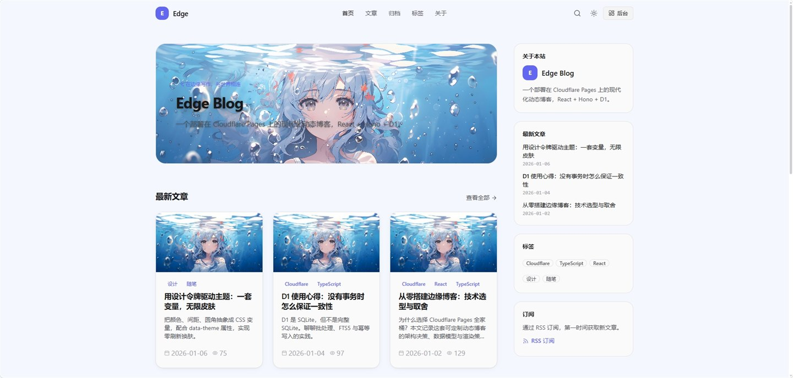
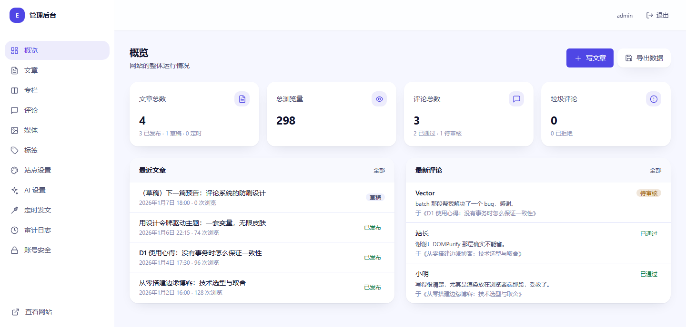
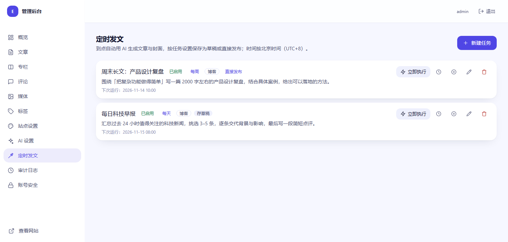
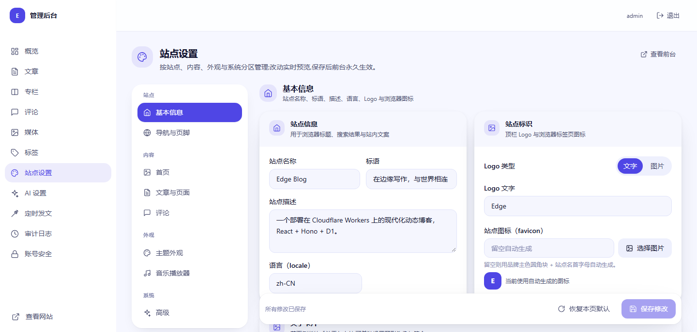
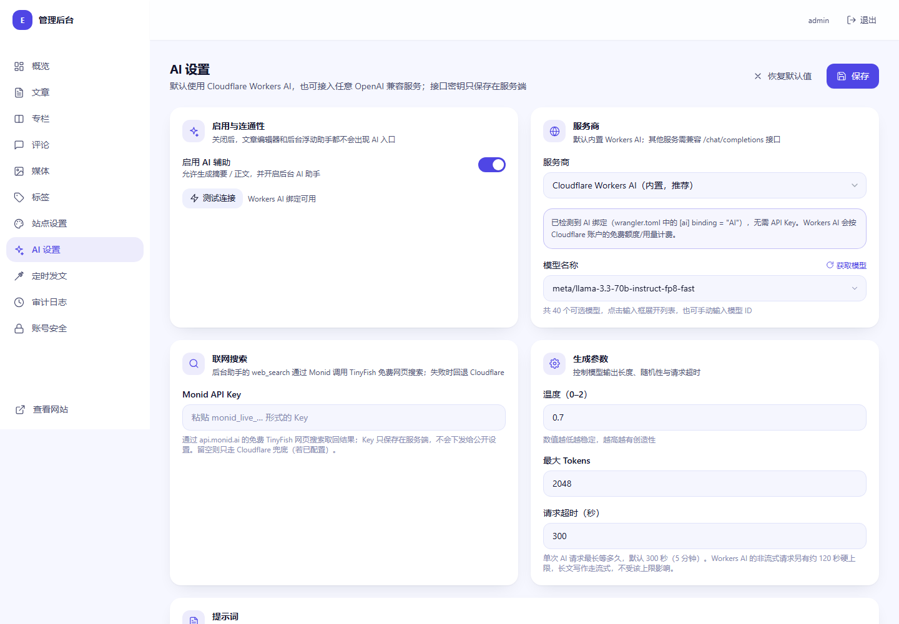

# Edge Blog

一个运行在 **Cloudflare Workers** 上的动态博客系统。内容与配置全部保存在边缘服务端，后台实时编辑；站点外观、布局、导航、首页模块都可以可视化配置，无需改代码。

[](LICENSE)
[](https://workers.cloudflare.com/)
[](https://react.dev/)
[](https://www.typescriptlang.org/)

[](https://deploy.workers.cloudflare.com/?url=https://github.com/nyoungo/EdgeBlog)

- 在线演示：<https://www.068800.xyz>
- 一键部署：点上面的按钮，Cloudflare 会自动创建 D1 / R2 / KV / Workers AI 并构建上线
- 非静态生成：页面是 SPA，数据通过 Worker 提供的 API 实时读取
- 无需服务器：D1 存数据，R2 存媒体，KV 做缓存与限流
- 定时发文：按排期自动生成整篇文章与封面图，并保存为草稿或直接发布

```
React + TypeScript + Vite  ·  React Router  ·  TailwindCSS + CSS 变量
Hono on Cloudflare Workers ·  D1 (SQLite + FTS5)  ·  R2  ·  KV  ·  Workers AI
JWT + HttpOnly Cookie      ·  PBKDF2-SHA256        ·  DOMPurify
```

## 界面预览

### 前台

| 首页 | 通栏 Hero + 叠图卡片 | 沉浸式全屏 Hero |
| :---: | :---: | :---: |
| [](docs/screenshots/home.jpg) | [](docs/screenshots/home-hero-fullwidth.jpg) | [](docs/screenshots/home-hero-fullscreen.jpg) |

> 同一套代码的三种排版：首页模块、Hero 宽度与背景、卡片样式均在后台「站点设置」中调整。

### 后台

| 概览 | 定时发文 |
| :---: | :---: |
| [](docs/screenshots/admin-dashboard.png) | [](docs/screenshots/admin-automation.png) |

| 站点设置 | AI 设置 |
| :---: | :---: |
| [](docs/screenshots/admin-appearance.png) | [](docs/screenshots/admin-ai.png) |

## 功能特性

### 内容

- Markdown 文章，支持草稿、定时发布、回收站（软删除）与彻底删除
- 专栏：可配置多个专栏，文章只能属于博客或某一个专栏，两类内容的列表、标签、归档、RSS 互不干扰
- 标签管理、归档页、相关文章、上一篇 / 下一篇
- 全文搜索：D1 FTS5 + trigram 分词，中文子串与英文大小写不敏感
- 嵌套评论、审核队列、访客评论开关、频率与长度限制
- 媒体库：图片 / MP4 / WebM 上传至 R2，图片按档位压缩，视频自动抽取封面
- 审计日志与文章 / 标签 / 媒体 / 配置的 JSON 导出
- RSS、sitemap、robots 动态生成

### 写作体验

- 带工具栏、快捷键、拖拽 / 粘贴上传、分栏预览与全屏的 Markdown 编辑器
- 本地草稿自动恢复，避免误关页面丢内容
- 内置 Cloudflare Workers AI（默认，无需 API Key），也可接入 OpenAI / DeepSeek / 任意 OpenAI 兼容服务，一键生成摘要、正文或使用后台浮动 AI 助手

### 定时发文

- 在后台「定时发文」页创建任务：填写生成提示词、目标位置（博客或某个专栏）与排期
- 每个任务可选「保存为草稿」或「直接发布上线」：前者生成后等你审核，后者到点即在前台可见
- 排期支持「仅一次 / 每天 / 每周 / 每月」+ 执行时刻（北京时间），可选首次执行日期与结束日期
- Worker 的 Cron Trigger 每 5 分钟唤醒一次，到期任务先抓取资料，再流式写完整篇正文，最后生成封面
- 封面可选「AI 生成 / AI 联网找图 / 指定图片 / 不设封面」：前两种会把图片存入 R2；「指定图片」支持媒体库图片或图片直链，外链在执行时下载入库（失败则保留原链接）
- 任务列表展示下次运行时间、上次结果与最近运行记录，可随时启用 / 停用或立即手动执行一次

### 微信公众号

- 在后台「公众号设置」页填入公众号 AppID / AppSecret，凭据只保存在服务端（`settings` 私有命名空间，绝不出现在公开配置接口）
- 文章编辑页「推送到公众号草稿」一键同步：正文 Markdown 在服务端渲染为内联样式 HTML，正文图片逐张上传到微信后回填 `mmbiz` 地址，封面作为永久素材获取 `thumb_media_id`
- 定时发文任务可选「同步到微信公众号草稿」，生成成功后自动推送；推送失败只记一条警告，不影响文章落库
- 同一篇文章重复推送会更新既有草稿（`wechat_drafts` 去重），不会在草稿箱堆重复项
- 标题超 32 字、摘要超 120 字自动截断；正文图仅支持 jpg/png 且单张小于 1MB，格式/体积不符会指名报错而不静默跳过

### 站点定制

- 6 套预设配色，每套包含亮色与暗色两套中性色；自定义主色自动派生文字色与悬停 / 按下色
- 全局背景图、字体、字号、圆角、内容宽度、行距、代码高亮主题
- 顶栏位置（跟随 / 吸顶 / 固定 / 左侧）、样式、背景、对齐与顶部透明
- Hero 支持视频 / 图片 / 颜色背景、宽高、铺满、遮罩、文字颜色与对齐
- 首页模块显隐与排序、卡片样式 / 尺寸 / 毛玻璃、侧边栏位置、每页条数
- 页脚、社交图标、评论区、可选音乐播放器
- 自定义 CSS、页头 / 页尾 HTML 注入、访问统计
- 所有修改实时生效，无需重新构建

## 技术栈

| 关注点 | 选择 | 说明 |
| --- | --- | --- |
| 前端 | React 18 + Vite + React Router 6 | SPA，后台路由懒加载 |
| 样式 | TailwindCSS + CSS 变量 | 颜色 / 圆角 / 字体全部引用 CSS 变量，运行时换肤 |
| 后端 | Hono on Cloudflare Workers | 基于 Web 标准 API，边缘运行；`scheduled` 处理定时任务 |
| 数据库 | Cloudflare D1 (SQLite) | 参数化查询，边缘只读副本 |
| 全文搜索 | D1 FTS5 + trigram | 解决 SQLite 默认分词器无法切分中文的问题 |
| 对象存储 | Cloudflare R2 | 图片与视频，零出口流量费 |
| 缓存 | Cloudflare KV | 公开配置缓存、限流计数 |
| 认证 | JWT (HS256) + HttpOnly Cookie | 会话版本号支持全端登出 |
| 密码 | PBKDF2-SHA256（210k 迭代） | Web Crypto 原生支持，旧哈希登录时自动升级 |
| Markdown | marked + DOMPurify + highlight.js | 浏览器端渲染、净化与高亮 |

## 部署到 Cloudflare Workers

本项目部署为 **Worker**（而非 Pages）：定时发文依赖 Worker 的 **Cron Trigger** 按固定频率唤醒，Pages 不支持定时触发。Worker 同时通过 `[assets]` 提供 `dist/` 里的静态资源，`run_worker_first` 让所有请求先经过 Worker。

### 一键部署

[](https://deploy.workers.cloudflare.com/?url=https://github.com/nyoungo/EdgeBlog)

点击按钮后：

1. 授权 GitHub。Cloudflare 会把仓库克隆到**你自己的账号**下，得到一个可以继续开发的副本。
2. 确认 Worker 名称与资源名，填写 `JWT_SECRET`。
3. 点击 **Deploy**。Cloudflare 读取 `wrangler.toml`，自动创建同名 D1 / KV / R2 与 Workers AI 绑定并回填 ID，然后构建并部署。

| 配置项 | 值 |
| --- | --- |
| Build command | `npm run build` |
| Deploy command | `npm run deploy` |
| `JWT_SECRET` | 至少 32 字符的随机串，用 `openssl rand -base64 48` 生成；**必须替换示例值** |

`npm run deploy` 会先运行 `scripts/db-bootstrap.mjs`：

- **空库**（还没有 `users` 表）→ 执行 `db/init.sql`，建表并写入默认配置与默认管理员；
- **已有数据的库** → 只做检查，不写任何东西，重复部署不会覆盖内容。

所以首次部署完成后就能直接使用，不需要再手工执行 SQL。

#### 部署完成后

1. 打开 `https://<Worker 名称>.<子域>.workers.dev/admin`，用 `admin` / `admin12345` 登录。
2. **立即修改密码**（后台「账号」页）。
3. 站点名、标语、配色、导航等在「后台 → 站点设置」里改；示例文章与默认数据可以直接删掉。
4. 需要自动写文时，在「后台 → 定时发文」创建任务。Cron 随 Worker 一起部署，可在 Worker → **Settings → Triggers** 看到 `*/5 * * * *`。

#### 绑定自定义域名（可选）

默认域名 `https://<Worker 名称>.<子域>.workers.dev` 功能完整。要绑定自己的域名，该域名必须是**当前 Cloudflare 账户下的 active zone**（在注册商处把 NS 指向 Cloudflare），然后在 Worker → **Settings → Domains & Routes → Add → Custom Domain** 添加。

> Workers 的 Custom Domain 不支持外部 DNS 的 CNAME 接入（这点与 Pages 不同）。域名托管在别处又不想迁入 Cloudflare 时，继续用 `workers.dev` 域名即可；媒体以相对路径 `/media/<key>` 保存，换域名不用迁移数据。

`SITE_URL` 默认留空，canonical / RSS / sitemap / OG 会自动跟随访问域名；想固定成某个地址时，把它填进 `wrangler.toml` 的 `[vars]` 再部署一次。

#### 常见问题

| 现象 | 原因 | 处理 |
| --- | --- | --- |
| 页面能打开但接口 500，提示 `JWT_SECRET` 未配置或长度不足 | Secret 还是示例值，或少于 32 字符 | 在 Worker → **Settings → Variables and Secrets** 重设，或执行 `npx wrangler secret put JWT_SECRET` |
| `no such table` / 后台一片空白 | 数据库初始化没有执行 | 查看构建日志里 `db-bootstrap` 是否通过；也可手动执行 `npm run db:bootstrap` |
| 手动执行 `npm run db:init` 报 `duplicate column name` | `db/init.sql` 只用于空库 | 已有数据的库不要再执行，只补跑缺少的迁移文件 |
| 添加 Custom Domain 失败 | 域名不在当前 Cloudflare 账户下 | 先把域名 NS 迁入 Cloudflare，或继续使用 `workers.dev` 域名 |
| 定时任务没有按点执行 | Cron 只在线上生效 | 线上无需操作；本地测试用 `npx wrangler dev --test-scheduled` 后访问 `/__scheduled` |

### 手动部署（可选）

不想用按钮、或想在自己电脑上部署时：

```bash
git clone https://github.com/nyoungo/EdgeBlog.git
cd EdgeBlog
npm install
npx wrangler login

# 创建资源（名字可自定义，创建后把 ID 填回 wrangler.toml）
npx wrangler d1 create edge-blog
npx wrangler kv namespace create CACHE
npx wrangler r2 bucket create edge-blog-media

# 设置登录密钥
npx wrangler secret put JWT_SECRET

# 构建 + 首次初始化数据库 + 部署
npm run deploy
```

后续更新：`git pull && npm run deploy`。

> 绑定名 `DB`、`MEDIA`、`CACHE`、`AI`、`ASSETS` 不要修改。`[ai] binding = "AI"` 让 Worker 直接调用 Workers AI（默认 AI 服务商，无需 API Key）；不需要 AI 时可以删掉这段绑定与 `[triggers]`，后台的 AI 与定时发文入口会自动隐藏。`[triggers]` 的 `crons = ["*/5 * * * *"]` 只是轮询频率，与具体任务的执行时刻无关。

也可以完全不用命令行：在 D1 的 **Console** 里粘贴 [`db/init.sql`](db/init.sql) 的全文（只适用于空库），再在 Worker 的 **Settings → Variables and Secrets** 里添加 `JWT_SECRET`。

### 升级已有站点

空库与新库都由 `db-bootstrap` 处理。**已经有数据**的站点升级时，新增的迁移不会自动执行，需要逐个应用新的迁移文件：

```bash
npx wrangler d1 execute DB --remote --file=./migrations/<新迁移>.sql
```

迁移文件只保证在对应的旧版本上执行一次，重复执行会报列已存在之类的错误；执行前先备份 D1。

### 默认账号

| 用户名 | 密码 | 权限 |
| --- | --- | --- |
| `admin` | `admin12345` | admin |

> 这是 `seed/seed.sql` 写入的初始账号，**部署后请立即修改密码**，也可以用 `npm run hash-password -- "新密码"` 生成哈希后更新 `users` 表。

## 环境变量

| 变量 | 配置位置 | 说明 |
| --- | --- | --- |
| `JWT_SECRET` | Dashboard Secret | 签署 JWT 的密钥，≥ 32 字符；缺失或过短时 API 直接返回 500 |
| `ENVIRONMENT` | `wrangler.toml` | `production` / `development`；开发环境 Cookie 不加 `Secure`，并允许 http 内网 AI 地址 |
| `SITE_URL` | `wrangler.toml` | 站点对外地址，用于 canonical / RSS / sitemap / OG；留空则自动跟随当前访问域名 |
| `MEDIA_PUBLIC_BASE` | `wrangler.toml` | 媒体公开前缀，默认留空（相对路径自动跟随访问域名）；仅当 R2 绑定了独立域名时设置 |
| `SESSION_COOKIE` | `wrangler.toml` | 会话 Cookie 名称，默认 `eb_session` |
| `ALLOWED_ORIGINS` | `wrangler.toml` | 额外允许的跨域来源，逗号分隔；同源始终允许，`*` 会被忽略 |

绑定：`DB`（D1）、`MEDIA`（R2）、`CACHE`（KV）、`AI`（Workers AI，可选）、`ASSETS`（Worker 静态资源）。

## 本地开发

需要 Node.js ≥ 18.18 与 Cloudflare 账号（`npx wrangler login`）。

```bash
npm install
cp .dev.vars.example .dev.vars   # 至少把 JWT_SECRET 换成 ≥ 32 字符的随机串
npm run db:init:local            # 首次：建表 + 种子数据（见下方说明）

npm run dev:worker  # 构建前端并启动 Worker，http://127.0.0.1:8788
```

> `dev:worker` 通过 `wrangler dev` 运行完整 Worker，**会加载 D1 / R2 / KV / AI 绑定**，API、定时发文与 AI 接口都可用。
> 也可以用 `npx wrangler dev` 触发定时器测试：`npx wrangler dev --test-scheduled` 后访问 `/__scheduled`。

> `db:init:local` 只适用于全新的本地数据库；已经有本地数据时不要重复执行，
> 改用 `npm run db:migrate:local` 补齐迁移，或用 `npm run db:seed:local` 单独写入种子数据。

只调试前端时，另开一个终端运行 `npm run dev`（Vite，`http://localhost:5173`），它会代理 `/api` 到 `8788`。这时需要在 `.dev.vars` 里取消注释 `ENVIRONMENT=development`、`SITE_URL` 与 `ALLOWED_ORIGINS` 三行：跨域来源被放行，Cookie 也不会因为 http 下的 `Secure` 标记而失效。

## 可用脚本

| 命令 | 说明 |
| --- | --- |
| `npm run dev` | 启动 Vite 开发服务器（HMR，`/api` 代理到 8788） |
| `npm run dev:worker` | 构建前端并用 wrangler 运行完整 Worker（含绑定与定时器） |
| `npm run build` | 类型检查 + 构建到 `dist/` |
| `npm run typecheck` | 前后端两套 tsconfig 类型检查 |
| `npm run lint` | ESLint（零警告） |
| `npm test` | Vitest 单元测试 |
| `npm run deploy` | 构建 + 初始化空数据库 + 部署（`wrangler deploy`） |
| `npm run db:bootstrap` | 部署前的数据库自举：空库执行 `db/init.sql`，已有数据的库只检查 |
| `npm run db:bundle` | 把迁移与种子数据合并生成 `db/init.sql` |
| `npm run db:init[:local]` | 用 `db/init.sql` 初始化全新数据库（远程 / 本地） |
| `npm run db:migrate[:local]` | 逐个应用 D1 迁移文件（远程 / 本地；仅空库，已有库请单独执行新迁移） |
| `npm run db:seed[:local]` | 写入种子数据（远程 / 本地） |
| `npm run db:reset:local` | 等同 `db:init:local`（不会删除已有本地库） |
| `npm run hash-password -- "密码"` | 生成 PBKDF2 密码哈希 |

> 所有 `db:*` 与部署命令都按**绑定名** `DB` 操作，不写死数据库名；一键部署把库改叫别的名字时命令依然可用。

## 项目结构

```
functions/              Worker 入口（Hono）：API、R2 代理、SEO 注入、RSS / sitemap / robots、定时任务
src/
  pages/                前台页面 + admin 后台页面
  components/           layout / ui / blog / admin 组件
  providers/            Settings（主题与配置）/ Auth / Toast
  lib/                  API 客户端、Markdown 渲染、主题引擎、格式化
  styles/               tokens.css（设计令牌）+ globals.css
shared/                 前后端共享类型、默认配置与排期计算
migrations/             D1 迁移（建表、FTS5、审计、软删除、定时发文等）
db/init.sql             合并后的初始化 SQL（npm run db:bundle 生成）
seed/                   示例文章、默认设置与管理员
scripts/                密码哈希、SQL 合并、部署前数据库自举
public/                 静态资源
docs/screenshots/       README 界面截图
index.html              SPA 外壳（首屏防闪烁脚本、SEO / 配置注入占位）
wrangler.toml           Worker + 静态资源 + Cron Trigger + D1 / R2 / KV 绑定
.dev.vars.example       本地开发与一键部署共用的 Secret 模板
```

## 定制与主题

所有可定制项按命名空间存于 `settings` 表（`site`、`theme`、`layout`、`navigation`、`social`、`features`、`advanced`、`comments`、`pages`），后台按页面区域分组展示，保存后通过 CSS 变量与 `data-theme` 实时生效。

- **主题**：设计令牌集中在 `src/styles/tokens.css`，采用 RGB 通道三元组，Tailwind 通过 `rgb(var(--c-x) / <alpha-value>)` 引用。`applyTheme()` 将配置写入内联 CSS 变量，并按主色的 WCAG 对比度自动选择前景色。
- **防闪烁**：`index.html` 内嵌阻塞式脚本，在首屏绘制前恢复 `data-mode` / `data-theme`；服务端同时注入合并后的公开配置（`#eb-boot-settings`），首帧即为真实站点信息。
- **Hero**：背景按视频 → 图片 → 颜色依次回退，视频静音播放，可设置循环或播放一次，以及自定义循环区间。整段循环或单次播放只挂载一个 `<video>`；只有自定义区间循环才启用双解码面，第二个视频在第一段开始播放后才加载，切点原子换层，无黑帧或 seek 卡顿。移动端不加载视频，直接使用封面图。
- **卡片**：`cardStyle` 控制五种卡片形态，`cardSize` 控制密度，`cardBlur` 为卡片启用毛玻璃。

## AI 辅助写作与后台助手

AI 功能默认关闭，不会迁移或覆盖已有配置。后台「AI 设置」页（`/admin/ai`）提供两种接入方式：

- **Cloudflare Workers AI（默认）**：通过 `wrangler.toml` 中的 `[ai] binding = "AI"` 直接调用，无需 API Key。默认模型 `@cf/meta/llama-3.3-70b-instruct-fp8-fast`，可在设置页手动输入或拉取其他文本生成模型。
- **OpenAI / DeepSeek / 自定义 OpenAI 兼容接口**：保存 API Key 后自动拉取模型列表，可配置 Base URL、温度、最大 Tokens、请求超时与提示词。已有配置会继续按原样工作。
- **请求超时**：单次 AI 请求的最长等待时间，默认 300 秒（5 分钟），可调 10–900 秒。Workers AI 的非流式请求另有约 120 秒硬上限，长文写作走流式，不受该上限影响。

开启后：

- 文章编辑器出现「AI 生成正文」「AI 生成摘要」入口
- 后台每个页面右下角出现可拖动的圆形 AI 助手，可对话式创建/修改文章、上传图片与视频、给视频设置封面、审核评论、查看统计，以及读取指定网页正文（http/https，HTML 转纯文本后供总结或改写）
- 助手执行的每次写操作都会写入审计日志（`via: 'ai'`）
- API Key 仅保存在服务端，接口只返回 `hasApiKey`；`/api/ai/generate` 与 `/api/ai/chat` 均由 Worker 代理请求

> 助手抓取网页与下载素材都走同一套地址校验：只放行 http/https，拒绝内网、回环与保留地址（含重定向后的最终地址），单页限 2MB。

### 联网搜索

助手提供两个联网工具：

- `web_search`：主通道通过 **Monid 搜索网关**（`api.monid.ai` → TinyFish 免费网页搜索）取回结果；失败或结果与关键词无关时回退 Cloudflare Web Search API。结果会做相关性校验：标题、摘要、链接里都找不到查询关键词（例如「雷军」被截成「雷」）就判为失败，不会把垃圾结果交给模型。
- `fetch_web_page`：读取指定网页正文（http/https），HTML 转纯文本后交给模型，默认 6000 字、上限 10000 字，单页 2MB。

Monid 搜索（推荐配置）：在后台「AI 设置 → 联网搜索」填入 `monid_live_…` 形式的 API Key 即可，Key 只保存在服务端。也可改用 `MONID_API_KEY` 环境变量 / secret 提供（后台配置优先）。该通道经 `api.monid.ai` 调用 TinyFish 的免费网页搜索，不消耗 Monid 钱包余额。

Cloudflare 兜底通道（可选；Monid 未配置或失败时使用）：

1. Cloudflare Dashboard → **AI Gateway** → 选中网关（默认 `default`）→ **Provider Keys** → 添加 Exa Key，别名填 `default`（即 BYOK，费用由 Exa 直接结算，可用每月 $10 免费额度）。
2. 需要换网关/供应商时，在 `wrangler.toml` 的 `[vars]` 里设置 `AI_GATEWAY_ID`、`SEARCH_PROVIDER`（`ceramic` / `exa` / `linkup`）、`SEARCH_BYOK_ALIAS`；省略 `SEARCH_BYOK_ALIAS` 时按 AI Gateway credits 计费。

> 两条通道都失败（或都未配置）时，助手会明确回报失败原因，不会编造搜索结果。

> Workers AI 调用会按 Cloudflare 账户的免费额度/用量计费，即使在本地的 `wrangler dev` 中也是如此。`npm run dev` 不会加载 Worker 与绑定，AI 相关接口不可用。

## 安全

- 所有 SQL 使用参数化查询
- Markdown 渲染后经 DOMPurify 净化，唯一入口为 `src/lib/markdown.ts`
- 登录与评论频率限制（KV 计数 + `login_attempts` 账本），AI 调用与上传另有配额
- 密码强度校验与 PBKDF2 加盐哈希，登录时自动升级旧哈希
- JWT 存于 `HttpOnly; Secure; SameSite=Lax` Cookie，写操作校验同源，`token_version` 支持会话吊销
- 上传校验 magic bytes、MIME 白名单与体积上限，入库失败回滚 R2 对象
- 统一安全响应头（CSP、nosniff、HSTS 等），预览域名自动 noindex
- CI 执行 lint / typecheck / test / build

## 贡献

欢迎提交 Issue 与 Pull Request。提交前请确保 `npm run lint`、`npm run typecheck` 与 `npm test` 全部通过。

## 许可证

本项目基于 [MIT License](LICENSE) 开源，© 2026 nyoung。
