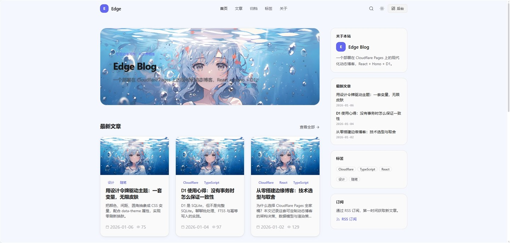
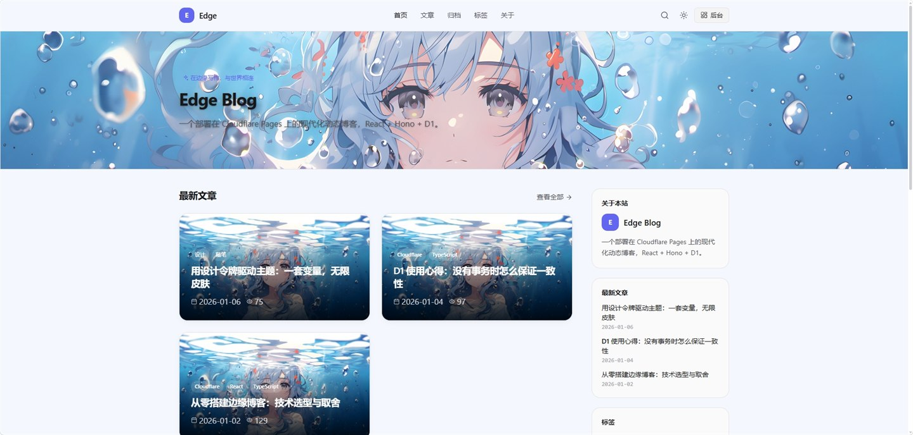
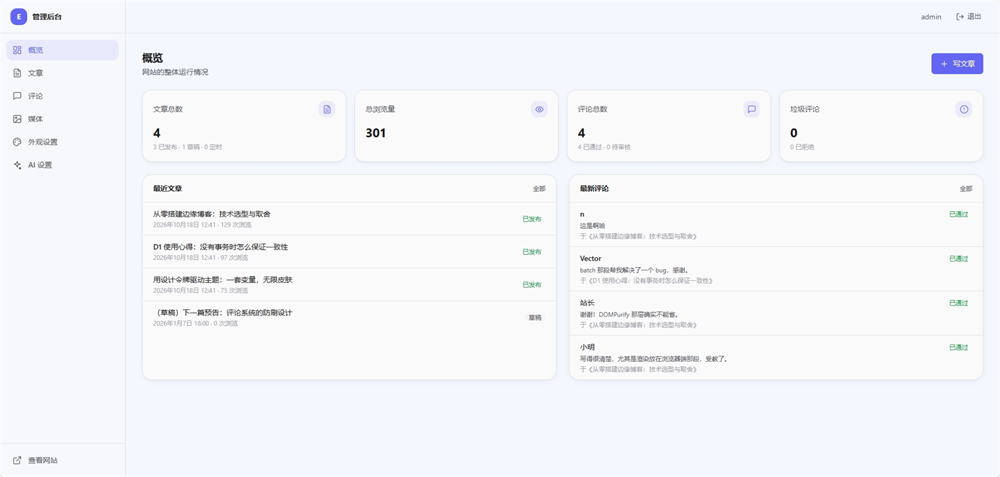
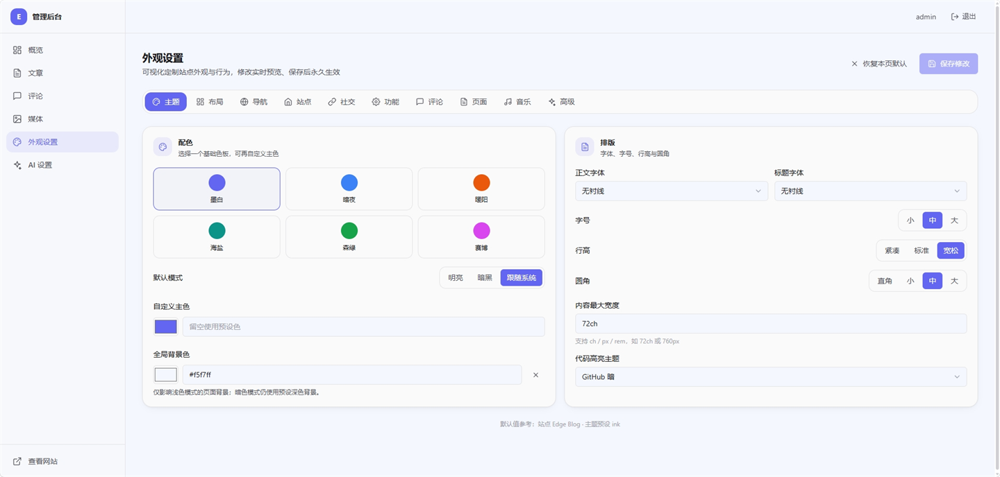
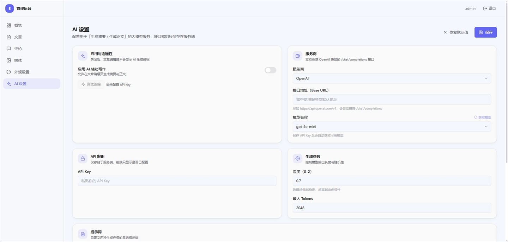

# Edge Blog

一个部署在 **Cloudflare Pages** 上的**动态博客系统**：内容与配置全部存于服务端，后台实时编辑；站点外观、布局、导航、模块开关全部可视化配置，无需改代码。

非静态生成 —— 页面是 SPA，数据通过 Pages Functions 提供的 API 实时读取。

```
React + TypeScript + Vite  ·  React Router  ·  TailwindCSS + CSS 变量
Hono on Pages Functions    ·  D1 (SQLite + FTS5)  ·  R2  ·  KV
JWT + HttpOnly Cookie      ·  PBKDF2-SHA256        ·  DOMPurify
```

---

## 界面预览

### 前台

| 首页 | 通栏 Hero + 叠图卡片 | 沉浸式全屏 Hero |
| :---: | :---: | :---: |
| [](docs/screenshots/home.jpg) | [](docs/screenshots/home-hero-fullwidth.jpg) | [](docs/screenshots/home-hero-fullscreen.jpg) |

> 同一套代码的三种排版：首页模块、Hero 宽度与背景、卡片样式均在后台「外观设置」中可视化调整，无需改动代码。

### 后台

| 概览 | 外观设置 | AI 设置 |
| :---: | :---: | :---: |
| [](docs/screenshots/admin-dashboard.png) | [](docs/screenshots/admin-appearance.png) | [](docs/screenshots/admin-ai.png) |

> 文章 / 评论 / 媒体管理、可视化外观定制与 AI 辅助写作（API Key 仅保存在服务端）。

---

## 目录结构

```
.
├─ functions/                 # 后端：Cloudflare Pages Functions（Hono）
│  ├─ [[path]].ts             #   全站入口：/api/* → Hono；/media/* → R2；HTML 导航 → 注入 meta 的外壳
│  ├─ api/                    #   业务路由（auth / posts / tags / comments / settings / media / search / stats + settings-schemas）
│  ├─ lib/                    #   db / auth / jwt / crypto / sanitize / response / rate-limit / settings / posts-repo / seo
│  ├─ rss.xml.ts              #   /rss.xml 动态生成
│  ├─ sitemap.xml.ts          #   /sitemap.xml 动态生成
│  └─ robots.txt.ts           #   /robots.txt
├─ src/                       # 前端：React SPA
│  ├─ main.tsx  App.tsx       #   入口 + 路由表（/admin 懒加载）
│  ├─ pages/                  #   前台页面 + pages/admin 后台页面
│  ├─ components/
│  │  ├─ layout/              #   Header / Footer / RootLayout（返回顶部、页脚注入）
│  │  ├─ ui/                  #   Button · Field · Modal · Switch · Badge · Pagination · icons …
│  │  ├─ blog/                #   PostCard · Prose · 目录 · 评论 · 分享
│  │  └─ admin/               #   MediaPicker 等后台专用组件
│  ├─ providers/              #   Settings（主题 + 配置）/ Auth / Toast
│  ├─ hooks/                  #   useAsync · useDebounced · useDocumentTitle …
│  ├─ lib/                    #   api client · markdown 渲染+净化 · theme 引擎 · format
│  └─ styles/                 #   tokens.css（设计令牌）+ globals.css
├─ shared/                    # 前后端共享的领域类型（唯一契约）
│  ├─ types.ts
│  └─ settings-defaults.ts    #   配置默认值（合并回退 + 「恢复默认」共用）
├─ migrations/                # D1 迁移
│  ├─ 0001_init.sql           #   基础表
│  └─ 0002_fts.sql            #   FTS5 全文索引 + 同步触发器
├─ seed/seed.sql              # 种子数据（默认设置 / 示例文章 / 管理员）
├─ scripts/hash-password.mjs  # 生成 PBKDF2 密码哈希
├─ public/                    # 静态资源（_headers / favicon 等）
├─ docs/screenshots/          # README 界面截图
├─ index.html                 # SPA 外壳（含首屏防闪烁脚本 + SEO / 配置注入占位）
├─ wrangler.toml              # Pages + D1/R2/KV 绑定配置
├─ tailwind.config.ts         # 颜色 / 圆角 / 字体全部映射到 CSS 变量
├─ vite.config.ts
└─ package.json
```

---

## 技术选型说明

| 关注点 | 选择 | 理由 |
| --- | --- | --- |
| 前端框架 | React 18 + Vite | 生态成熟、HMR 极快、SSR 不需要（Pages 已负责 HTML 外壳） |
| 路由 | React Router 6 | 声明式路由，支持嵌套布局与懒加载 |
| 样式 | TailwindCSS + CSS 变量 | 原子类保证视觉一致；所有颜色/圆角/字体引用 CSS 变量，实现运行时换肤 |
| 后端 | Hono on Pages Functions | 体积小、Web 标准 API、TypeScript 类型友好、中间件模型清晰 |
| 数据库 | D1 (SQLite) | 边缘只读副本、参数化查询、SQL 直观 |
| 全文搜索 | **D1 FTS5 虚表 + trigram 分词器** | 见下方「为什么是 trigram」 |
| 对象存储 | R2 | 零出口流量费，天然适合图片 |
| 缓存 | KV | 缓存全站配置与热点文章；同时做登录/评论的频率计数 |
| 认证 | 自建 JWT（HS256）+ HttpOnly Secure Cookie | 无第三方依赖，可在 Workers 内用 Web Crypto 完成 |
| 密码 | PBKDF2-SHA256 (100k 迭代) | Web Crypto 原生支持，Workers 零依赖 |
| Markdown | marked | 快、体积小、GFM 开箱即用 |
| 净化 | DOMPurify（浏览器端） | 见下方「XSS 净化策略」 |
| 代码高亮 | highlight.js | 体积可控、按需注册语言、主题可配 |

### 为什么是 trigram 分词器

D1 是 SQLite，但没有交互式事务，且默认 `unicode61` 分词器**无法切分中文** —— 一整段中文会被当作一个 token，子串搜索永远返回空。FTS5 的 `trigram` 分词器按 3 字符窗口建索引，使中文**子串**搜索与 ASCII 大小写不敏感搜索都能工作。代价是查询需 ≥ 3 个字符，因此搜索接口对短查询回退到 `LIKE` 扫描（见 `functions/api/search`）。

### XSS 净化策略（重要）

Markdown → HTML 的渲染与净化**都在浏览器端**完成：

```ts
marked.parse(md)  →  DOMPurify.sanitize(html)  →  dangerouslySetInnerHTML
```

原因：DOMPurify 需要真实 DOM，而 Workers 没有 `window`。把「渲染 + 净化」一起放在浏览器，既不必在边缘维护 DOM shim，也让净化更难被绕过。若在 Worker 侧渲染却不净化，后台编辑器就等同于开了个 XSS 后门 —— 因此这条链路是**强制**的，`src/lib/markdown.ts` 是唯一的渲染入口，禁止在别处直接使用 `marked`。

SEO 所需的 `title / description / og:image` 由 `functions/[[path]].ts` 在返回的 `index.html` 外壳里注入，爬虫与社交卡片拿得到正确的 meta。

### SPA 回退

不使用 `public/_redirects` 的 `/* /index.html 200`（它会把 `/api/*` 也吞掉）。改为在 `functions/[[path]].ts` 里显式处理：`/api/*` → Hono；其余若是 HTML 请求且静态资源 404 → 返回注入了 meta 的 `index.html`。控制权在代码里，路径优先级清晰。

---

## 快速开始

> 前置：Node.js ≥ 18.18，以及一个 Cloudflare 账号（`npx wrangler login`）。

### 1. 安装依赖

```bash
npm install
```

### 2. 创建 Cloudflare 资源

```bash
# D1 数据库
npx wrangler d1 create edge-blog
#   → 把输出的 database_id 填进 wrangler.toml 的 [[d1_databases]]

# R2 存储桶
npx wrangler r2 bucket create edge-blog-media
#   → 建议给桶绑定自定义域名，并填入 wrangler.toml 的 MEDIA_PUBLIC_BASE

# KV 命名空间
npx wrangler kv namespace create CACHE
#   → 把输出的 id 填进 wrangler.toml 的 [[kv_namespaces]]
```

### 3. 初始化数据库（本地）

```bash
npm run db:migrate:local   # 建表 + FTS5
npm run db:seed:local      # 示例数据 + 默认设置 + 管理员
```

### 4. 配置密钥

```bash
cp .dev.vars.example .dev.vars
# 编辑 .dev.vars，把 JWT_SECRET 换成随机长字符串：
#   openssl rand -base64 48
```

### 5. 运行

本项目的**完整功能**由 Pages Functions 提供，因此本地开发使用 `wrangler pages dev`：

```bash
npm run build          # 产出 dist/
npm run dev:pages      # http://127.0.0.1:8788
```

若只想调前端（用 Vite 的 HMR），另开一个终端跑 `npm run dev`（Vite 会把 `/api` 代理到 `8788`）。

### 6. 部署到生产

```bash
# 应用迁移到远程 D1
npm run db:migrate
npm run db:seed        # 仅首次

# 设置生产密钥
npx wrangler pages secret put JWT_SECRET --project-name edge-blog

# 构建并部署
npm run deploy
```

---

## 默认账号

| 用户名 | 密码 | 权限 |
| --- | --- | --- |
| `admin` | `admin12345` | admin |

> **部署后请立即修改密码。** 生成新哈希：
> ```bash
> npm run hash-password -- "你的新密码"
> npx wrangler d1 execute edge-blog --remote \
>   --command "UPDATE users SET password_hash='<输出的哈希>' WHERE username='admin';"
> ```
> 开发期最快的方式：登录后进入 `/admin` 修改。

---

## 环境变量

| 变量 | 位置 | 说明 |
| --- | --- | --- |
| `JWT_SECRET` | Secret | 签署 JWT 的密钥，≥ 32 字符 |
| `ENVIRONMENT` | vars | `production` / `development`（`development` 时 Cookie 不加 `Secure`） |
| `SITE_URL` | vars | 站点对外地址，用于 RSS / sitemap / canonical |
| `MEDIA_PUBLIC_BASE` | vars | R2 对象的公开访问前缀 |
| `SESSION_COOKIE` | vars | 会话 Cookie 名称，默认 `eb_session` |
| `ALLOWED_ORIGINS` | vars | CORS 白名单，同源部署填 `*` 即可 |

绑定：`DB`(D1) · `MEDIA`(R2) · `CACHE`(KV) · `ASSETS`(Pages 静态资源)。

---

## 数据模型

| 表 | 用途 |
| --- | --- |
| `users` | 管理员/编辑，PBKDF2 密码哈希 |
| `posts` | 文章正文(Markdown)、状态、定时发布、SEO 覆盖、字数、浏览量 |
| `tags` / `post_tags` | 标签与多对多关联 |
| `comments` | 嵌套评论，审核状态，`ip_hash` 仅用于防刷 |
| `settings` | 全站配置，按命名空间存 JSON —— 定制系统的单一事实来源 |
| `media` | R2 对象索引 |
| `login_attempts` | 登录限流的持久化账本 |
| `posts_fts` | FTS5 全文索引（trigram），由触发器与 `posts` 同步 |

---

## 定制化系统

所有可定制项抽象为配置命名空间，存于 `settings` 表，后台可视化修改，**实时生效**（CSS 变量 + `data-theme` 驱动，不刷新页面）：

1. **品牌** — 站名、副标题、Logo（文字/图片）、favicon（留空则自动生成「品牌主色 + 站名首字母」图标）、页脚版权
2. **主题** — 6 套预设配色（墨白/暗夜/暖阳/海盐/森绿/赛博）、自定义主色、明暗模式（亮/暗/跟随系统）、正文与标题字体、字号档位、圆角、内容宽度、行距、代码高亮主题
3. **布局** — 首页模块显隐与拖拽排序、侧边栏位置、文章卡片样式、每页条数
4. **导航** — 菜单项增删改与排序（支持外链、新窗口）
5. **社交** — GitHub / X / 邮箱等，图标自动匹配
6. **功能开关** — 评论、搜索、RSS、浏览量、View Transitions、TOC、相关文章…
7. **进阶** — 自定义 CSS、页头/页尾注入 HTML

---

## AI 辅助写作

后台侧边栏的「AI 设置」页（`/admin/ai`，配置存于 `settings` 表的 `ai` 命名空间，**不进入公开配置**）：

- **服务商** — OpenAI / DeepSeek / 自定义（任意 OpenAI 兼容的 `/chat/completions`）
- **模型** — 保存 API Key 后自动拉取服务商模型列表（`GET /models`）并以下拉选择，可随时点「获取模型」刷新
- **参数** — Base URL、温度、最大 Tokens，以及「生成摘要」「生成正文」两套系统提示词
- **密钥安全** — API Key 仅保存在服务端，接口只返回 `hasApiKey` 布尔值；`/api/ai/generate` 由 Functions 代理请求，浏览器拿不到密钥
- **连通性测试** — 一键用当前配置发起一次真实请求

文章编辑器（`/admin/posts/new` 或编辑页）在配置就绪后会出现两个入口：正文工具栏的 **AI 生成正文**（按标题/要点追加成文）与摘要栏的 **AI 生成**。

---

## API 一览

所有接口统一返回信封：成功 `{ ok: true, data, meta? }`，失败 `{ ok: false, error: { code, message, details? } }`。
写操作（POST/PUT/PATCH/DELETE）需通过同源 CSRF 校验；带 🔒 的接口需要登录会话。

| 方法 | 路径 | 说明 |
| --- | --- | --- |
| GET | `/api/health` | 健康检查 |
| POST | `/api/auth/login` | 登录，签发 HttpOnly Cookie |
| POST | `/api/auth/logout` | 登出 |
| GET | `/api/auth/me` | 当前会话用户 |
| POST | `/api/auth/password` 🔒 | 修改密码（校验旧密码 + 强度） |
| GET | `/api/posts` | 公开文章列表（`page`/`perPage`/`tag`/`q`/`sort`/`featured`） |
| GET | `/api/posts/:slug` | 文章详情 + 标签 + 上一篇/下一篇 + 相关 |
| POST | `/api/posts/:slug/view` | 浏览量 +1（KV 去重 / 尊重功能开关） |
| GET | `/api/posts/admin` 🔒 | 后台文章列表（含草稿/定时/筛选） |
| POST | `/api/posts` 🔒 | 新建文章（自动 slug、摘要、标签） |
| PUT | `/api/posts/:id` 🔒 | 更新文章 |
| DELETE | `/api/posts/:id` 🔒 | 删除文章 |
| GET | `/api/tags` | 标签及文章数 |
| POST/PUT/DELETE | `/api/tags[/:id]` 🔒 | 标签增删改 |
| GET | `/api/comments/post/:slug` | 已审核评论（嵌套树） |
| POST | `/api/comments` | 提交评论（蜜罐 + 频率限制 + 审核） |
| GET | `/api/comments` 🔒 | 后台评论列表（按状态/文章/关键词筛选） |
| PATCH | `/api/comments/:id` 🔒 | 审核（approved/rejected/spam/pending） |
| DELETE | `/api/comments/:id` 🔒 | 删除评论（级联子评论） |
| GET | `/api/settings/public` | 公开配置（KV 缓存 60s，驱动主题） |
| GET | `/api/settings` 🔒 | 原始配置 + 默认值（外观面板用） |
| PATCH | `/api/settings/:namespace` 🔒 | 增量更新某命名空间（对象深合并 / 数组整体替换） |
| POST | `/api/settings/reset` 🔒 | 恢复默认（可指定命名空间） |
| GET | `/api/media` 🔒 | 媒体库分页 |
| POST | `/api/media/upload` 🔒 | 上传图片到 R2（multipart，≤8MB；前端可选客户端压缩） |
| DELETE | `/api/media/:id` 🔒 | 删除媒体（同时删 R2 对象） |
| GET | `/api/search?q=` | 全文搜索（FTS5，短词自动回退 LIKE） |
| GET | `/api/stats` 🔒 | 仪表盘统计（文章/浏览量/评论） |
| GET | `/api/ai/settings` 🔒 | AI 配置（密钥以 `hasApiKey` 代替，绝不回传明文） |
| PATCH | `/api/ai/settings` 🔒 | 更新 AI 配置（空 `apiKey` = 保持不变，`clearApiKey` 可清除） |
| POST | `/api/ai/models` 🔒 | 拉取服务商可用模型列表（使用已保存的密钥） |
| POST | `/api/ai/generate` 🔒 | 代理调用大模型，生成摘要 / 正文（服务端持有密钥） |

`namespace` ∈ `site · theme · layout · navigation · social · features · advanced · comments · pages`（`ai` 为后台专用命名空间，不进入公开配置）。

> 时间戳统一以 SQLite 的 `YYYY-MM-DD HH:MM:SS`（UTC）格式存储 —— 公开可见性用字符串比较 `published_at <= datetime('now')`，混用 ISO 会静默破坏排序。API 出入的 `publishedAt` 接受 ISO 字符串，由 `toSqlDateTime` 归一。

---

## 分阶段交付

- [x] **阶段 1** — 项目结构 · 数据库 schema · FTS5 · 种子 · wrangler 配置 · 技术选型
- [x] **阶段 2** — 后端 API（认证、文章、标签、评论、设置、上传）
- [x] **阶段 3** — 前端框架（路由、主题系统、布局组件、设计令牌）
- [x] **阶段 4** — 前台页面（首页、列表、详情、归档、标签、搜索、关于）
- [x] **阶段 5** — 后台页面（登录、仪表盘、编辑器、评论、媒体、外观设置、AI 设置）
- [x] **阶段 6** — SEO / RSS / sitemap / 性能优化 / 部署文档

---

## 阶段 1 验收清单

```bash
# 1) 依赖解析（不装也行，仅校验 package.json 合法）
node -e "JSON.parse(require('fs').readFileSync('package.json','utf8')); console.log('package.json OK')"

# 2) 迁移可执行（需要已创建 D1 并填好 wrangler.toml 的 database_id）
npm run db:migrate:local

# 3) 表已建好
npx wrangler d1 execute edge-blog --local \
  --command "SELECT name FROM sqlite_master WHERE type IN ('table','trigger') ORDER BY name;"
# 期望看到：comments, login_attempts, media, post_tags, posts, posts_fts,
#           settings, tags, users 及相关 trigger。

# 4) 种子写入成功
npm run db:seed:local
npx wrangler d1 execute edge-blog --local --command "SELECT count(*) AS posts FROM posts;"
# 期望：4

# 5) 中文全文搜索可用（trigram 分词）
#    注意：trigram 要求查询词 >= 3 个字符，2 字词请走 LIKE 回退（由搜索 API 处理）
npx wrangler d1 execute edge-blog --local \
  --command "SELECT rowid, title FROM posts_fts WHERE posts_fts MATCH '边缘博' LIMIT 5;"
# 期望：返回 rowid=1「从零搭建边缘博客…」
# 英文/大小写不敏感同样可用：
npx wrangler d1 execute edge-blog --local \
  --command "SELECT rowid, title FROM posts_fts WHERE posts_fts MATCH 'cloudflare' LIMIT 5;"

# 6) 管理员账号存在
npx wrangler d1 execute edge-blog --local \
  --command "SELECT id, username, role FROM users;"
# 期望：1 | admin | admin
```

---

## 阶段 2 验收清单

完整功能依赖 Pages Functions，本地用 `wrangler pages dev` 运行：

```bash
npm run build            # typecheck + vite build → dist/
npm run dev:pages        # http://127.0.0.1:8788
```

另开一个终端验证（Windows 可用 `Invoke-RestMethod` 替代 curl）：

```bash
# 公开读
curl -s localhost:8788/api/health
curl -s localhost:8788/api/settings/public
curl -s "localhost:8788/api/posts?perPage=2"
curl -s localhost:8788/api/posts/hello-edge-blog
curl -s "localhost:8788/api/search?q=%E8%BE%B9%E7%BC%98%E5%8D%9A"   # 中文 FTS
curl -s localhost:8788/api/comments/post/hello-edge-blog

# 登录（保存会话 Cookie）
curl -s -c jar.txt -X POST localhost:8788/api/auth/login \
  -H 'content-type: application/json' \
  -d '{"username":"admin","password":"admin12345"}'

# 受保护接口
curl -s -b jar.txt localhost:8788/api/stats
curl -s -b jar.txt "localhost:8788/api/comments?status=pending"
curl -s -b jar.txt "localhost:8788/api/posts/admin?status=draft"

# 配置热更新 + 恢复默认（改完立即生效，无需重启）
curl -s -b jar.txt -X PATCH localhost:8788/api/settings/theme \
  -H 'content-type: application/json' -d '{"preset":"cyber","mode":"dark"}'
curl -s -b jar.txt -X POST localhost:8788/api/settings/reset \
  -H 'content-type: application/json' -d '{"namespace":"theme"}'

# 上传图片到 R2
curl -s -b jar.txt -X POST localhost:8788/api/media/upload -F "file=@cover.png"
```

上传图片时可切换压缩档位（不压缩 / 轻度 / 中等 / 高度，默认**中等**，记住上次选择）。
前端用 canvas 等比缩放并按质量重编码为 WebP（不支持 WebP 时回退 JPEG / PNG），
动图与 SVG 原样上传；重编码后反而更大时保留原图。

**本阶段已实机验证通过（32 项）**：公开读 / FTS 中英检索 / 登录限流与错误密码 401 /
会话解析 / 文章 CRUD / 草稿对公开不可见 / 评论提交（待审）· 蜜罐静默接受 · 审核 /
媒体 上传→访问→删除（R2）/ 设置 深合并·数组替换·恢复默认 /
安全（CSRF 403、未授权 401、校验 422）。

---

## 前端架构

### 主题系统（运行时换肤）

设计令牌集中在 `src/styles/tokens.css`：中性色阶 + 单一强调色以「RGB 通道三元组」定义，`tailwind.config.ts` 通过 `rgb(var(--c-x) / <alpha-value>)` 引用，**改一个变量即可整站换色，无需重编译**。

- `data-mode="light|dark"` 控制明暗（`:root` 与 `[data-mode="dark"]` 两套值）
- `data-theme="<preset>"` 只覆盖强调色（墨白/暗夜/暖阳/海盐/森绿/赛博）
- `src/lib/theme.ts` 的 `applyTheme()` 把配置写成内联 CSS 变量（圆角、内容宽度、字号、行高、字体栈、自定义主色）
- `index.html` 内嵌**阻塞式**脚本，在首屏绘制前从 `localStorage` 与内联配置恢复 `data-mode` / `data-theme`，杜绝主题闪烁（FOUC）
- `prefers-reduced-motion` 时全局禁用动画与过渡

### 数据与状态

- `SettingsProvider`：优先同步读取外壳内联的配置（`<script id="eb-boot-settings" type="application/json">`，由 `injectBootSettings` 写入），首帧即为站点真实名称/主题，**不闪默认值**、且省去一次 `/api/settings/public` 请求；无内联配置时（如 `vite dev`）才回退到拉取 `/api/settings/public` 并与默认值合并。改配置时**实时**重写 CSS 变量并注入自定义 CSS / 页头页脚 / 统计脚本
- `AuthProvider`：`/auth/me` 探测会话，提供 `login / logout`
- `ToastProvider`：全局通知
- `useAsync(loader, deps)`：统一的 loading / error / reload 数据钩子

### Markdown 渲染链

唯一入口 `src/lib/markdown.ts`：`marked` 渲染 → `DOMPurify` 净化（白名单标签/属性）→ `highlight.js` 高亮 → 交给 `Prose` 组件 `dangerouslySetInnerHTML`；详情页据此抽取目录（TOC）。

### 路由

`src/App.tsx`：前台（首页 / 列表 / 详情 / 标签 / 归档 / 搜索 / 关于 / 404）挂在 `RootLayout` 下；`/admin/*` 整体 `lazy()` 懒加载，访客不会下载后台代码；`AdminLayout` 内做登录守卫并二次 `Suspense`。

### 设置如何生效

- **主题 / 高级**：配置变化时 `SettingsProvider` 调用 `applyTheme` + `applyAdvanced`，实时写入 CSS 变量（`--c-brand` 主色、`--c-bg` 全局背景色等）、切换代码高亮主题、注入自定义 CSS 与页头/页脚 HTML（`<script>` 会被重建以真正执行）、统计脚本 → 后台改动即时预览。
- **布局**：`layout.sidebar` 由 `PageWithSidebar` 在首页/列表/标签/归档/搜索页渲染侧边栏（居左 / 居右 / 不显示，`lg` 以下自动堆叠）；`layout.cardStyle` 驱动 `PostCard` 的五种形态（杂志 / 极简 / 网格 / 浮层 / 紧凑），`layout.cardSize`（大 / 中 / 小）控制内边距、字号与列表密度（经 `cardGridClass` 统一栅格），`layout.cardBlur`（无 / 弱 / 中 / 强）为卡片加毛玻璃 `backdrop-blur`；`layout.homeModules` 控制首页模块及顺序。
- **欢迎区（Hero）**：`layout.hero` 定制宽度（标准 / 窄 / 全宽）、高度、铺满屏幕、背景色 / 渐变、背景图、亮/暗主题遮罩、标题 / 描述文字颜色与对齐；开启「铺满屏幕」后宽度与高度自动锁定（互斥），欢迎区渲染在侧边栏容器之外直接占满视口宽度、向上覆盖导航栏区域（内容略微上移）。
- **导航栏**：`layout.header` 定制位置（跟随页面 / 吸顶 / 固定 / 左侧竖向侧边栏）、样式（默认 / 极简 / 胶囊）、背景（纯色 / 玻璃 / 透明）、顶部透明、高度与对齐；固定定位时自动补占位高度，`左侧` 时桌面端（`lg` 起）渲染固定竖向侧边栏并把内容右移 `16rem`，移动端仍用顶部栏，且侧边栏同样应用样式（默认 / 极简 / 胶囊）、背景（纯色 / 玻璃 / 透明）、对齐（左 / 中 / 右）与高度设置。
- **交互**：`features.viewTransitions` 开启时，站内导航使用 View Transitions API。
- **音乐**：`music.enabled` 为真时 `MusicPlayerHost` 才动态加载 `xf-music-player` 并挂到页面右下角；后台改配置会销毁并按新参数重建。

### 音乐播放器（XF Music Player）

可选的访客端悬浮播放器，**默认关闭**，在后台「外观 → 音乐」开启：

- 通过 `import('xf-music-player')` **动态懒加载**，关闭时零体积进入主包；开启后单独产出一个约 110 KB(gzip) 的异步 chunk
- 数据源二选一：**云端接口**（`apiUrl`，需返回 `{ code, msg, data: [...] }`）或**本地歌单**（后台逐条编辑，以 JSON 存于设置表）
- `MusicPlayerHost` 单例持有 `MusicPlayer` 实例并串行化创建/销毁，规避严格模式下的重复挂载与音频泄漏
- 语言 / 播放模式 / 主题 / 尺寸（宽度、底部距离、歌单高度、可视数量）/ 音量 / 自动展开 / 彩色歌词 / 可视化 / 记忆播放均可在后台配置
- **强调色始终跟随博客主题色**：通过 `customThemeStyle` 注入 `--theme-color` 等变量（取自设计令牌 `--c-brand`，随主题预设与自定义主色变化）；主题选 `auto-theme` 时按博客当前亮暗模式回落到 `xf-dark-theme` / `xf-original-theme`，而非跟随系统
- 不涉及 CSP 调整：站点文档本身未声明 CSP，外部播放器与音频/图片可正常加载

---

## SEO / 订阅 / 站点地图

| 路径 | 实现 | 说明 |
| --- | --- | --- |
| `/*`（HTML 导航） | `functions/lib/seo.ts` | 取静态外壳，注入 `<title>` / description / canonical / Open Graph / Twitter Card / JSON-LD（首页 WebSite、文章 BlogPosting），并把合并后的公开配置内联为 `#eb-boot-settings`（客户端首帧直接水合，避免闪现默认站点名）后返回 |
| `/rss.xml` | `functions/rss.xml.ts` | 最新 20 篇公开文章；`features.rss` 关闭时 404 |
| `/sitemap.xml` | `functions/sitemap.xml.ts` | 静态页 + 全部公开文章，含 `lastmod` |
| `/robots.txt` | `functions/robots.txt.ts` | 放行全站、屏蔽 `/admin` 与 `/api/`，声明 Sitemap |

SEO 注入失败时**不影响页面下发**（try/catch 回退原始外壳）；canonical 与绝对链接使用 `SITE_URL`。

---

## 阶段 3–6 验收清单

```bash
npm run typecheck        # 前后端两套 tsconfig 均通过
npm run build            # 产出 dist/（代码分割：react-vendor / markdown / 各后台页）
npm run dev:pages        # http://127.0.0.1:8788
```

浏览器：首页各模块（hero/最新/精选/标签/订阅）、文章详情的封面 / 目录 / 上一篇下一篇 / 相关文章 / 评论、
标签页、归档页（按年分组）、搜索页（防抖 + 中英）、关于页 Markdown；
右上角主题切换（明亮/暗黑/跟随系统）即时生效且刷新后保持；
后台 `/admin` 全流程：登录 → 概览 → 新建/编辑文章 → 评论审核 → 媒体上传 → 外观设置（实时预览 + 保存 + 恢复默认）。

HTTP 层（注意带上 `Accept: text/html`）：

```bash
curl -s -H 'Accept: text/html' localhost:8788/ | grep '<title>'
curl -s -H 'Accept: text/html' localhost:8788/posts/hello-edge-blog | grep 'BlogPosting'
curl -s localhost:8788/rss.xml | head -c 200
curl -s localhost:8788/sitemap.xml | grep urlset
curl -s localhost:8788/robots.txt
```

**已实机验证**：SEO / RSS / sitemap / robots 20 项断言全通过；API 冒烟 29 项全通过；
`typecheck`（前端 + Functions）0 error；`vite build` 成功。

---

## 安全清单（贯穿各阶段实现）

- 所有 SQL 参数化（`prepare().bind()`），禁止字符串拼接
- Markdown 渲染后经 DOMPurify 净化，唯一入口 `src/lib/markdown.ts`
- 登录/评论频率限制（KV 计数 + `login_attempts` 账本）
- 密码强度校验、PBKDF2-SHA256 加盐哈希
- JWT 存于 `HttpOnly; Secure; SameSite=Lax` Cookie；写操作校验同源（CSRF）
- 后台 API 全部经过会话中间件；敏感操作二次校验登录态
- 评论内容纯文本转义后存储/展示，`email` 永不对外暴露
- 上传接口校验 MIME 白名单与体积上限
- 统一安全响应头（CSP / nosniff / HSTS 等，见 `public/_headers` 与 API 中间件）

---

## 许可证

本项目基于 [MIT License](LICENSE) 开源，© 2026 nyoung。
